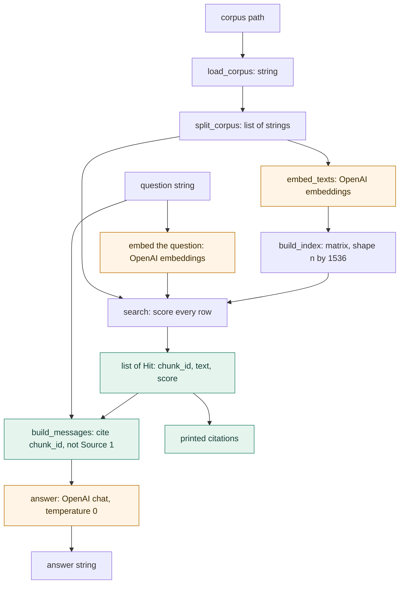

# Week 1 retrieval app

The green nodes are the citation change from the notebook experiment: retrieved hits keep their index row, and the prompt is told to cite that id instead of renumbering passages as Source 1.

OpenAI is called in three places: once to embed the chunks, once to embed the question, and once to write the answer. A new process embeds the chunks again. It does not keep the matrix.
