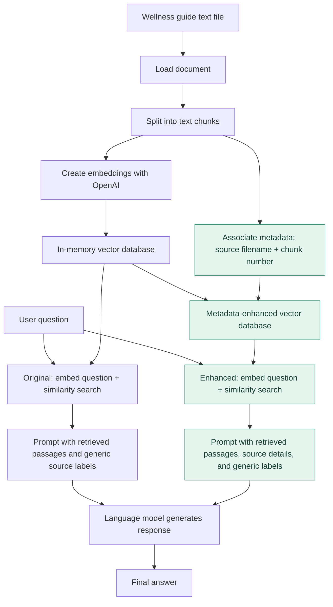

# Week 1 — Wellness Assistant RAG Pipeline

This diagram shows the original retrieval path alongside the source-metadata enhancement implemented for Activity #1. It describes the notebook architecture; it is not a production deployment diagram.

## What changed

The **original** pipeline returned passage text and a similarity score. The **enhanced** retrieval path adds a filename and a chunk number to each returned passage while reusing the original embeddings and similarity search. The prompt-building code still adds generic `Source 1`, `Source 2`, etc. labels; as observed in the comparison, those generic labels may remain in the generated answer.

## Observed comparison

The top three retrieved passages matched in the same order. Similarity scores differed slightly across separate searches (roughly 0.00002–0.00007). Both generated answers were substantively similar, and the enhanced version did not automatically surface the filename/chunk details in its final citations.
